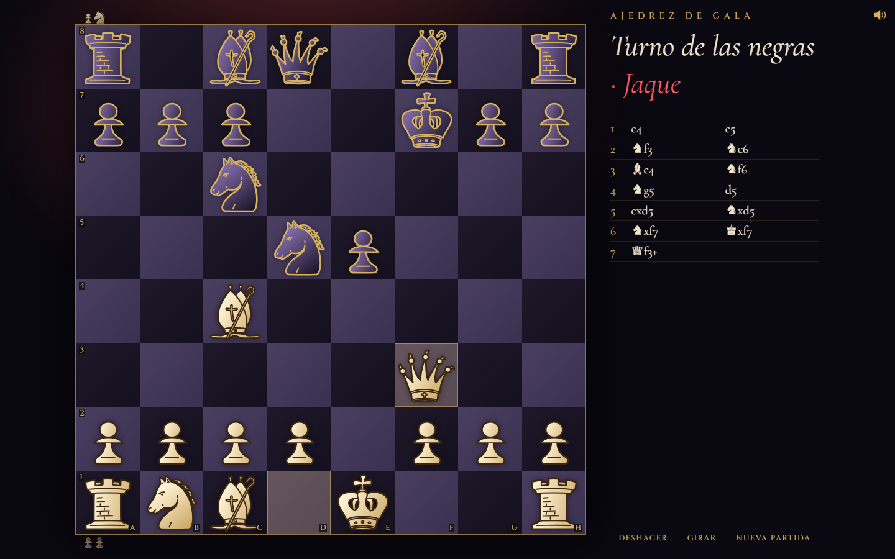

# Ajedrez de Gala

Ajedrez a la luz del foco, con piezas de marfil y oro. Juega con otra persona o contra la Máquina. Gratis y sin registro.

Pruébala: https://tunneller-demo.github.io/ajedrez/

Construida con Tunneller.
